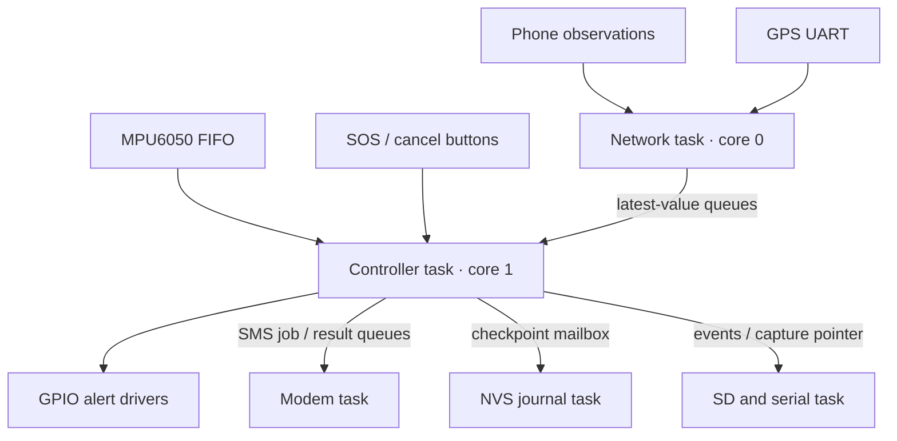
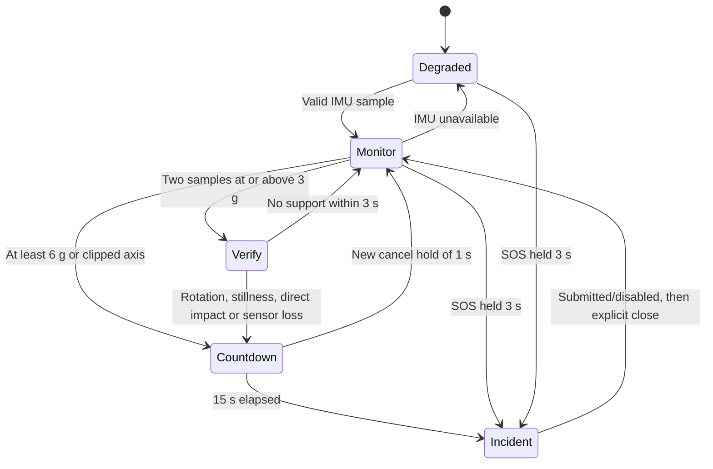

# Core architecture and decisions

Only the controller task calls `Core`. Its 5 ms cycle reads buttons, processes
bounded commands and FIFO samples, consumes peripheral results, applies alerts,
and publishes work to asynchronous tasks. No SD writes, modem waits or network
calls occur there. The MPU6050 uses bounded I2C transactions (3 ms timeout per
transaction); scheduling is not claimed hard real-time. The controller feeds a
5 s task watchdog. A watchdog reset is recovery, not proof of deadline compliance.

## Crash / SOS logic

The diagram omits transitions for brevity: SOS works in Verify/Countdown too;
return-to-monitor becomes Degraded if the IMU is unavailable. Confirmed recent
absence can suppress automatic handling events at candidate entry. Unknown wear
state cannot. Removing the helmet does not cancel an existing countdown.

| Parameter | Prototype value / logic |
|---|---|
| Accel / gyro ranges | ±16 g / ±2000 degrees/s, MPU6050 DLPF 3, 200 Hz |
| Moderate candidate | Two consecutive magnitudes ≥3 g; gap >20 ms resets streak |
| Direct candidate | Magnitude ≥6 g or any axis near clipping |
| Rotation support | Magnitude ≥200 degrees/s during verification |
| Stillness support | ≥1 s, ≥150 samples; 0.8–1.2 g, gyro ≤10 degrees/s, accel standard deviation ≤0.1 g |
| Verification window | 3 s; unsupported candidate rejected |
| IMU missing | >100 ms; Verify escalates uncertain, Countdown remains active |
| Cancel | Debounce 30 ms + new 1 s hold; existing held button must be released |
| Manual SOS | Debounce 30 ms + 3 s hold; held-at-boot is disarmed until released |
| Countdown | 15 s; local pulses start immediately |
| Wear absence | Absence ≤1.5 s old and no presence in previous 10 s |

These settings need calibration with collected non-crash riding/handling data
and controlled fixtures. They do not estimate injury severity. Hardware wear
state currently stays Unknown because no head-presence adapter is implemented.

## Alert priority and outputs

Emergency → countdown → system fault → combined road → pothole → wet → rear.
Emergency and countdown use buzzer plus vibration; advisories use vibration/LED.
Emergency pulses 250 ms every 600 ms; countdown 150 ms each second; advisories
repeat every 5 s while fresh detections persist. New advisories pulse immediately.
`ack` or the cancel hold in Incident acknowledges the local alarm, but leaves
pending SMS retries active. `close` is accepted only after submission or disabled
SMS. No cloud/phone command can create or cancel an emergency.

Both vibration channels activate together by default. Only one motor is mapped
in the proposed pin map. The portable core supports directional gating but it is
disabled: helmet orientation, camera geometry and blind-spot zones are unvalidated.

## SMS and recovery

An incident has device/boot/sequence identity. Queued → Attempting → Submitted,
Failed, Unknown or Disabled. Failed/Unknown retry after approximately 15, 30, 60,
120 and 300 seconds, capped at 300 seconds, plus <1 s jitter. Unknown means the
modem might have submitted the message; later jobs retain the ID and `RETRY?` label.
There is no delivery guarantee and `+CMGS` is not recipient delivery confirmation.
The worker watchdog resolves a stuck attempt as Unknown after 90 s.

The AT engine performs attention, echo-off, SIM-ready, registration, text-mode,
GSM charset, recipient prompt, body and submission-response stages. It requires a
valid `+CMGS` reference; bare `OK` is insufficient. Timeout after handing off the
body is Unknown. It assumes an already-powered compatible modem in command mode;
PWRKEY, ESC recovery after an abandoned prompt, flow control, delivery reports and
variant-specific LTE/operator setup remain hardware integration work.

Each SMS is labelled TEST and includes manual SOS or suspected event, ID, and
fresh/old/unavailable GPS. Location freshness is 10 s. There is no automatic later
GPS update or post-send cancellation message in this release.

The NVS worker persists state transitions asynchronously using a CRC-protected
72-byte record. On reboot, an unfinished attempt becomes Unknown with the same
ID; a submitted/disabled record is not resent. Recovered Countdown starts a fresh
15 s window because powered-off duration is unknown. BENCH and HARDWARE use
separate NVS namespaces. A corrupt record raises a sticky system fault for that
boot. Sudden power loss before a write completes can lose the latest transition
or cause a duplicate; this is not transactional exactly-once delivery.

## Recording

A caller-owned ring retains up to 10 s of motion; the first candidate/SOS starts
one immutable event capture with up to 30 s of post-trigger samples. Allocations
occur only at boot: 2001 history / 8002 event entries in PSRAM. Internal-RAM
fallback retains roughly 1 s before / 6 s after at 200 Hz and marks the capture
truncated. Allocation failure disables recording and reports a system fault;
alerts and SMS can continue. Simultaneous captures are counted as missed.

The storage task serializes motion after capture completes. SD absence/failure
cannot block the controller; a failed mounted card requires restart after repair.
Event queue overflow increments a visible counter, not an emergency suppression.
RAM captures are lost on power loss. Final RSZ1 markers identify completed files;
CRC checks detect corrupt records, not authenticity or all storage failures.

All formats are explicitly little-endian. Event/motion/end records are 48 bytes:
magic at 0, record size at 4, monotonic ms at 8, payload from 16, CRC32 at 44.
Motion payload is six float32 axes followed by flags: simulated=1, clipped=2,
estimated FIFO timestamps=4. End markers store count at16, truncated at20, ID at24.
Event payload stores device/boot/sequence at16, kind at28, float value at32, detail
at36. CRC covers bytes 0..43. Times are uptime, not UTC.
